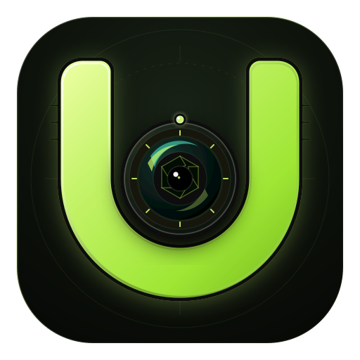

<p align="center"></p>

# Ultimate Webcam

Turn an Android phone into a USB webcam for Windows. A native desktop studio controls the camera, processes the picture, and exposes a virtual camera to Discord and other video applications. The phone displays the processed broadcast preview.

**Current version: 1.3.2.** Tested on Redmi A3 and Nothing Phone (3a). This is an early public release; supported modes depend on the phone.

[Download](https://github.com/Enan511/ultimate-webcam/releases/latest) · [Installation](docs/INSTALLATION.md) · [Build from source](docs/BUILDING.md) · [Troubleshooting](docs/TROUBLESHOOTING.md)

## Download and run

1. Download `Ultimate-Webcam-1.3.2-Windows-x64.zip` from [Releases](https://github.com/Enan511/ultimate-webcam/releases/tag/v1.3.2) and extract the entire archive into a writable folder.
2. Install `Phone App/UWebcam.apk` on an Android 9+ phone. The same APK is available separately in the release.
3. Enable USB debugging, connect a data-capable USB cable, and authorize your computer on the phone.
4. Open **UWebcam**, allow camera access, then open **Ultimate-Webcam.exe** on Windows.
5. Open the studio's **Setup** guide and install the virtual camera if prompted. Approve the Windows administrator prompt for registration.
6. In your meeting app, select **Ultimate Webcam** or **Unity Video Capture**, as shown in the studio. Fully restart the meeting app if it was open during driver registration.

Keep the executable, ADB files, `Phone App`, installer scripts, and `drivers` together. GitHub's automatic **Source code** archives do not contain the ready-to-run software.

## Features

- **Minimum delay** at 240p (480p fallback), or **Fast 1080p** with hardware H.264.
- Front/rear lens selection, supported resolution and frame rate, zoom, exposure, and fill light.
- Automatic portrait/landscape orientation, including when screen rotation is locked.
- Live desktop preview and processed broadcast preview on the phone.
- Picture presets, brightness, contrast, saturation, warmth, sharpness, vignette, mirror, and rotation.
- Optional phone microphone through VB-Audio Virtual Cable; muted by default.
- Saved Windows close behavior: **Quit and stop camera** (default) or **Keep running in tray**.
- Camera shutdown after Android task removal or desktop media disconnection. Tray mode keeps broadcasting until Quit.
- Local USB transport with hidden ADB subprocesses; no cloud video upload.

## Requirements and limits

The supplied desktop binary targets **Windows x64**; Windows 11 was used for validation. The phone needs **Android 9+**, camera permission, and an authorized USB debugging connection. The desktop runtime needs a DirectX 12-capable graphics path. Optional microphone forwarding needs a separately installed virtual audio cable.

**The requested 20 ms delay target has not been reached.** Redmi A3 checks measured about 80–83 ms median capture-to-native-output in Minimum delay and 145–175 ms at 1080p. Display refresh and meeting-app buffering add delay. These are timestamp estimates, not optical end-to-end measurements. See [testing and limits](docs/TESTING.md).

## Documentation

| Guide | Contents |
| --- | --- |
| [Installation](docs/INSTALLATION.md) | Phone and PC setup, Discord, modes, tray behavior, audio, uninstall |
| [Building](docs/BUILDING.md) | Dependencies, Windows/Android builds, signing, packaging |
| [Troubleshooting](docs/TROUBLESHOOTING.md) | USB authorization, missing camera, interrupted streams, delay |
| [Architecture](docs/ARCHITECTURE.md) | Capture, transport, processing, previews, shutdown |
| [Testing](docs/TESTING.md) | Verified behavior, measurements, diagnostic commands |
| [Wire protocol](protocol/wire_protocol_spec.md) | Packet framing and control commands |
| [Changelog](CHANGELOG.md) | Release changes |
| [Third-party notices](THIRD_PARTY_NOTICES.md) | Bundled components and licenses |

## Source layout

```text
android-webcam-app/       Kotlin / Camera2 companion
pc-webcam-studio/         React UI and Tauri / Rust host
assets/branding/          Canonical SVG and adaptive icon source
drivers/UnityCapture/    Driver source reference and license
protocol/                Socket protocol specification
tests/                   Phone integration diagnostics
scripts/                 Dependency notice collection
docs/                    User and developer guides
```

Compiled apps, ADB, and driver binaries are distributed in **Releases**. Local chat handovers, logs, device identifiers, SDK paths, build caches, and signing keys are excluded from source control.

## License

Project source uses the [MIT license](LICENSE), consistent with its existing Rust package metadata. Third-party components retain their own licenses; see [notices](THIRD_PARTY_NOTICES.md) and the files bundled with the release.
