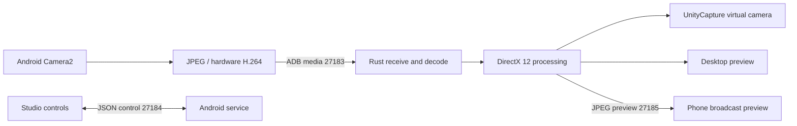

# Architecture

Android Camera2 produces hardware H.264 for full HD or independent JPEG frames for Minimum delay. Its foreground service owns capture, optional PCM audio, orientation, and telemetry. Three loopback sockets bind to `127.0.0.1` and are forwarded over USB by ADB. The app does not upload frames to a cloud service.

The Tauri desktop uses React controls and a Rust media pipeline. It decodes H.264 with OpenH264, uses packed AVX2 RGBA conversion where available, processes pictures through wgpu/DirectX 12, and writes the UnityCapture shared-memory interface. A portable conversion fallback is available. GPU errors are reported while an unprocessed picture can continue.

Socket reads, decode, and rendering run separately. Queues are bounded; independent images replace older images and H.264 overflow requests a keyframe. Negotiated acknowledgements can bound USB transport buffering. Desktop preview reads the latest binary frame on frame-ready notifications. Phone processed preview uses a separate connection, reduced resolution, and up to 30 fps while visible; dimming/backgrounding suspends that preview without changing full-resolution virtual output.

Orientation uses phone placement and per-lens sensor geometry, with boundary hysteresis and a stable angle when flat. Processed geometry is shared by previews and virtual output.

Actual desktop exit cancels capture and sends STOP_STREAM through a fresh, bounded control socket. Close-to-tray only hides the window. Android task removal stops the service; media disconnection pauses camera/audio, releases its wake lock, and removes the foreground notification.

See the [wire protocol](../protocol/wire_protocol_spec.md). The phone supports one media client, so diagnostics must run with the studio stopped.
